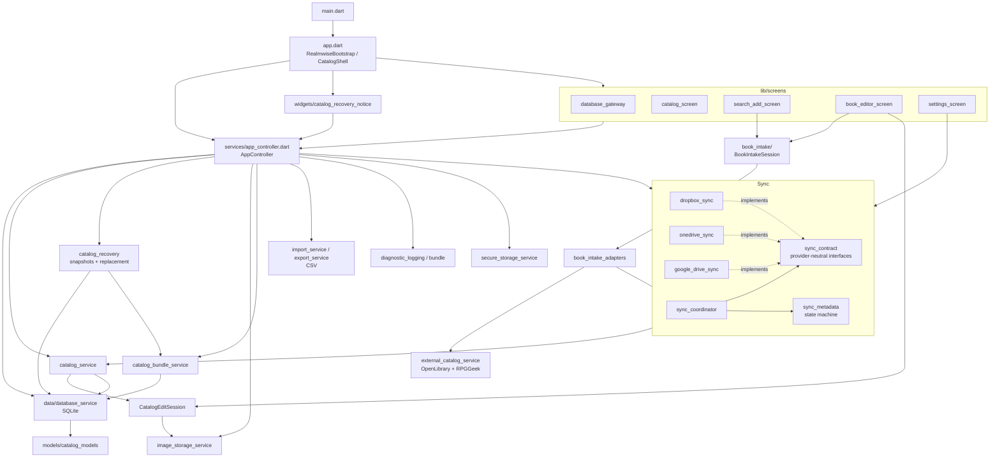

# Architecture map

Snapshot of `main` at `8263258` (2026-11-12), after the automatic-sync fixes (#98), centralized catalog recovery (#101), and staged record editing (#104). Realmwise is a single Flutter package (no internal packages) targeting Windows, Linux, and Android. Domain terms (**work**, **owned copy**, **work candidate**) are defined in [`CONTEXT.md`](../CONTEXT.md); decisions live in [`docs/adr/`](adr/); planned changes live in [`docs/spec/`](spec/).

## Layers

`AppController` is the composition root and the single `ChangeNotifier` the UI listens to. Screens call controller methods. Three paths reach past it into services directly:

- the settings screen, which calls sync and `controller.recovery`;
- book intake;
- the book editor, which holds a `CatalogEditSession` from `controller.catalog.beginEditing`.

## Modules

| Area | Files | Responsibility | Notes |
| --- | --- | --- | --- |
| Bootstrap | `main.dart`, `app.dart` | Loads Android OAuth config, builds the three sync providers, constructs `AppController`, optionally starts the debug harness, hosts `CatalogShell` navigation and the recovery-review banner. | Debug harness is opt-in (`apiDebugHarnessEnabled()`). |
| Orchestration | `services/app_controller.dart` (~1670 lines) | Database open/create/close, sync connect/disconnect, the automatic-sync scheduler and lease renewal, bundle import/export, theme and hierarchy preferences, catalog icons, RPGGeek key, CSV import/export, "new this session" tracking. Wires `CatalogRecovery` callbacks (`waitForSync`, `beforeClose`, `reopen`, `rehydrate`, `onReady`). | Still the largest seam. The automatic-sync scheduler is a stop-gap here until the sync session module (spec 002, #102) takes it over. |
| Domain model | `models/catalog_models.dart` | `BookWork`, `UserCopy`, `BookCondition`, `BookImage`, `CatalogRecord` (work + copies + images), `WorkCandidate`. | Immutable value types with `copyWith` / map serialization. |
| Persistence | `data/database_service.dart` | SQLite via `sqflite` (FFI on desktop). Tables `works`, `copies`, `images`, `settings`, `catalog_icons`. Schema version 5 with additive `onUpgrade` migrations. Owns catalog identity, `catalogGeneration` (bumped on every open), and `withCatalogFiles`, the lock that keeps image-file changes consistent with bundle snapshots. | Schema changes need a version bump and an upgrade step. `withCatalogFiles` is not re-entrant. |
| Catalog use cases | `services/catalog_service.dart` | Suggestions and tags; `beginEditing` → `CatalogEditSession`; delete and image rehydration under the catalog-files lock; `discardEdits` and `cleanupAbandonedEdits`. One image normalization rule (exactly one cover, order by `sortOrder`) for saves, CSV import, and extracted bundles. | Owns visit-scoped record editing (spec 004). |
| Record editing | `CatalogEditSession` in `services/catalog_service.dart` | Draft edits plus staged images for one visit to the editor. `save()` downloads any remote cover into staging, then, under `withCatalogFiles`, publishes staged files, writes rows in one transaction, and deletes removed files only after commit. A failed transaction renames published files back. `discard()` waits for an in-flight save, then removes staging. | Sessions from an earlier catalog open are invalid (`catalogGeneration`). Files still referenced by another work or a catalog icon are never deleted. |
| Book intake | `book_intake/book_intake_session.dart`, `book_intake_adapters.dart` | Visit-scoped lookup → candidate selection → duplicate check → editor handoff. Typed outcomes (`IntakeDuplicateRequest`, `IntakeEditorRequest`, `IntakeRefreshCandidate`, ...). Dependencies are interfaces (`BookIntakeLookup`, `BookIntakeCatalog`, `BookIntakePreferences`, `BookIntakeKeyProvider`). | Implements [ADR 0001](adr/0001-book-intake-session.md). The best-isolated, best-tested module; use it as the pattern for new seams. |
| External lookup | `services/external_catalog_service.dart` | OpenLibrary search by ISBN/title/author; optional RPGGeek XML enrichment (RPGGeek values win). | Network only on user action. |
| Images | `services/image_storage_service.dart` | Downloads covers with format sniffing, ISBN-based filenames, managed local folder. Edit staging lives under `<image root>/.staging/process-<pid>-<stamp>/edit-*`, owned through an exclusive lock file per process folder. `cleanupAbandonedEdits` removes only folders whose lock it can acquire, plus orphaned lock files. | Custom TLS/socket hooks exist for testability. Each new staging owner gets a fresh process folder. |
| Local recovery | `services/catalog_recovery.dart`, `widgets/catalog_recovery_notice.dart` | Every local snapshot and every catalog replacement (bundle import, restore point, remote download). See the recovery details below. | Implements spec 001. Desktop and Android share one path; Android reopens replacements in its default journal mode. |
| Bundles | `services/catalog_bundle_service.dart` | `.realmwise` zip: `manifest.json` + `catalog.db` (+ optional personal images), logical fingerprint, validation, extraction. Export runs under `withCatalogFiles`. | Used by manual export/restore, recovery snapshots, and every sync provider. |
| Sync contract | `services/sync_contract.dart` | Provider-neutral interfaces: `SyncProvider`, `SyncAuthenticator`, `SyncTransfer`, `SyncLeaseProvider`, revisions/preconditions, conflict and lease exceptions. | Change here ripples into all three providers. |
| Sync orchestration | `services/sync_coordinator.dart`, `sync_metadata.dart` | Connect, classify local vs remote, resolve conflicts, upload/download, the automatic-sync lease (single active device), rebind after restore. Metadata is stored per catalog identity in shared preferences. `SyncMetadata.copyWith` keeps a field unless it is in `clearFields`; passing `null` never clears. | Model is one active device + controlled handoff, never a merge. Automatic upload skips the transfer when the local fingerprint matches the last successful one. A `remoteOnly` result during remote validation is a conflict, never an upload. |
| Sync providers | `google_drive_sync.dart`, `onedrive_sync.dart`, `dropbox_sync.dart` + `*_runtime.dart` | OAuth (PKCE, loopback on desktop, platform callbacks on Android), token stores, provider-specific HTTP. `*_runtime.dart` holds the platform glue and build-mode (DEV/PROD) client selection. | Each provider ~650–1130 lines with parallel structure. All three accept a same-owner reacquire of an expired lease. |
| Secrets | `services/secure_storage_service.dart` | `TokenStorage` over `flutter_secure_storage`. OAuth tokens and the RPGGeek key (keyed by catalog identity) live here. | Legacy plaintext key in the DB is migrated out on read. Recovery scrubs legacy token rows from snapshots. |
| Diagnostics | `diagnostic_logging.dart`, `diagnostic_bundle_*.dart`, `sync_debug.dart` | Sanitizing logger, opt-in debug logging, exportable diagnostic bundle. | See [`diagnostics-privacy.md`](diagnostics-privacy.md). Recovery and edit failures emit `errorClass` only. |
| Debug harness | `debug/api_debug_harness.dart`, `docs/openapi.yaml` | Loopback-only HTTP API + Swagger for exercising lookups. | Opt-in; never ships enabled. |
| UI | `screens/*`, `widgets/*`, `theme/app_theme.dart` | Catalog hierarchy (system → setting → type → title), add/search with barcode scanning, editor, settings (database, sync, appearance, diagnostics). Themes, cover placeholders, recovery-review banner. | `settings_screen.dart` (~1740 lines) and `book_editor_screen.dart` / `catalog_screen.dart` (~1100 each) are the largest widgets. The editor no longer calls `ImageStorageService` directly. |

### Local recovery details

`CatalogRecovery` owns local snapshots and catalog replacement.

**Snapshots**

- Kinds:
  - `routine`: every 10 minutes while a catalog is open.
  - `manual`.
  - Protective: `preImport`, `preRestore`, `preConflict`, `preDownload`, `preRemoteOverwrite`.
- Retention: the newest 12 routine snapshots, and 5 of each other kind.
- Location: `<catalog dir>/backups/`. Listing and retention are scoped to the active catalog's file name.
- Content: legacy token rows are scrubbed from every snapshot.

**Replacement**

`replaceCatalog` runs these steps in order:

1. Stage and validate the replacement.
2. `waitForSync`: cancel and drain sync.
3. Stop routine snapshots.
4. Take the protective snapshot.
5. Run a `wal_checkpoint(TRUNCATE)`. The replacement is refused while another connection is busy.
6. Write the review marker.
7. `beforeClose`: discard edit sessions.
8. Close, copy, and swap the original to a rollback file. Its sidecars move with it.
9. Reopen and rehydrate.
10. Restart routine snapshots and call `onReady`.

**Failure after close**

- The original is restored and reopened, and the original error propagates.
- If the original can't be restored but the replacement can be reopened, the replacement stays active. A persistent review marker, `<catalog>.recovery-review.json`, then fences "Sync now", upload-to-remote, and automatic sync until the user acknowledges the banner.
- A deliberate replacement that commits clears any earlier marker.

**Cleanup**

- Failed deletes of staged and rollback files leave a `.cleanup-pending` marker and are retried at the next start or snapshot.
- Unmarked staged copies are always swept.
- An unmarked rollback is never swept, because it may be the user's original.

**Startup**

`recoverInterruptedReplacement` runs before the saved catalog is opened. If the saved file is missing and a review marker exists, it restores the newest rollback that has no `.cleanup-pending` marker.

### Automatic sync lifecycle

These rules live in `AppController`.

**Lease**

- 10-minute lease, renewed every 5 minutes while the app is in the foreground.
- Lease renewal, `syncNow`, policy changes, takeover, and each transfer run through `_serialize`.
- Losing the lease goes through the coordinator's single `lease_lost` path.

**Edits**

- Edits debounce for 5 s.
- An edit made during a run, or while the app is in the background, stays pending. It resumes when the current serialized operation or tracked activity finishes.

**Foreground and background**

- Desktop focus loss (`inactive`) still counts as foreground.
- `hidden`, `paused`, and `detached` flush a pending upload.
- The lease is refreshed on `resumed` only after the app was hidden or paused.

**Long remote operations**

- Takeover, remote validation, conflict resolution, and remote downloads are tracked in `_syncActivities`. Each activity runs in a zone with an expiring token.
- While any tracked activity is in flight, automatic uploads are blocked. This includes the retry backoff of a download.
- A replacement started inside an activity doesn't wait on its own caller.

**Close, disconnect, disable, dispose**

- These cancel the active automatic upload before draining.
- Provider disconnect keeps open edit sessions. Close, reopen, and replacement discard them.

## Key flows

- **Startup:**
  1. `RealmwiseBootstrap` → `AppController.initialize()`.
  2. `recoverInterruptedReplacement(saved)`.
  3. Reopen the last database (or show `DatabaseGateway`): load any review marker, restore sync metadata for the catalog identity, start recovery snapshots, clean abandoned edit staging.
  4. Refresh the automatic-sync lease (`_resumeAfterRecovery`).
- **Add or edit a book:**
  1. `SearchAddScreen` → `BookIntakeSession` lookup → the user picks a candidate → ISBN-13 duplicate check → `BookEditorScreen`.
  2. The editor works on a `CatalogEditSession`: images are staged, and cover, removal, and field changes stay in draft.
  3. Save publishes files and commits rows under the catalog-files lock. Back, cancel, or dispose discards staging.
  4. The controller notifies → automatic sync is scheduled (5 s debounce).
- **Sync:**
  1. `SyncCoordinator.classify` compares the local fingerprint and metadata with the remote revision.
  2. The result is an upload, a download, or `SyncDecisionRequired` for the user.
  3. A download replaces the catalog through `CatalogRecovery` (`preDownload` snapshot), then rebinds the remote baseline unless the result needs review.
- **Import / restore:** Settings → `restoreDeviceBundle` or `restoreFromBackup(RestorePoint)` → `CatalogRecovery.replaceCatalog` → `CatalogReplacementResult` (a review notice if the replacement was retained).

## Tests

`test/` has 33 files, mostly one per module.

- **Controller tests:**
  - `app_controller_automatic_sync_test.dart` uses a fake clock and timers.
  - `app_controller_recovery_test.dart`, `app_controller_edit_sync_test.dart`, and `app_controller_secure_token_test.dart` cover recovery, editing during sync, and token handling.
- **Cross-module:** `integrated_catalog_lifecycle_test.dart` covers restore, edit, and export together, and import while a sync is held.
- **Recovery:** `catalog_recovery_test.dart` uses injectable copy/rename/delete seams and real WAL readers.
- **Sync providers:** tested against fake HTTP clients.
- **Intake:** tested through its interfaces, per ADR 0001.
- **Widgets:** drawer, navigation, editor, search, settings, and the recovery notice.

CI (`.github/workflows/ci.yml`) runs `dart format --set-exit-if-changed`, `flutter analyze`, `flutter test`, SBOM checks, an artifact roundtrip, CodeQL, and smoke builds for all three platforms.

## Known hotspots and drift

Observations for planning:

- **`AppController` still mixes concerns:** database lifecycle, sync scheduling, bundles, preferences, and icons. Recovery moved out to `CatalogRecovery` (#101), and record editing moved out to `CatalogService` (#104). The automatic-sync scheduler remains here until the sync session module (spec 002, #102). The file carries several overlapping fences (`_serialize`, `_syncActivities`, the coordinator's `_exclusive`, the pending flags). #102 should collapse them into one.
- **Open recovery follow-ups:**
  - #113 tightens startup recovery. It records the exact rollback for each swap, handles a stale marker when recovery declines, and makes the marker write crash-safe.
  - #114 makes sure a save that finishes during replacement is in the protective snapshot.
- **Rollback files are not restore points.** A retained replacement's original sits at `<catalog>.rollback-<stamp>.tmp`. Settings lists only `backups/`, so recovering that file by hand means finding it on disk.
- **Misleading name:** `disconnectOneDrive()` delegates to `disconnectGoogleDrive()`, which actually disconnects whichever provider is active.
- **Stale version:** `CatalogBundleService.appVersion` is hard-coded to `1.0.0+1` while `pubspec.yaml` is `1.3.0+6`.
- **README drift:** the README says the RPGGeek key is stored in the local database, but it now lives in secure storage. The README's project map also still lists "backups" under `lib/services/` and undersells `test/`.
- **Stray file:** an empty file named `$null` is tracked at the repo root (from a PowerShell redirect).
- **Backlog:** items live in [`todo.md`](../todo.md) (duplicate detection beyond ISBN-13; consistent ISBN-13 checksum on typed input).
