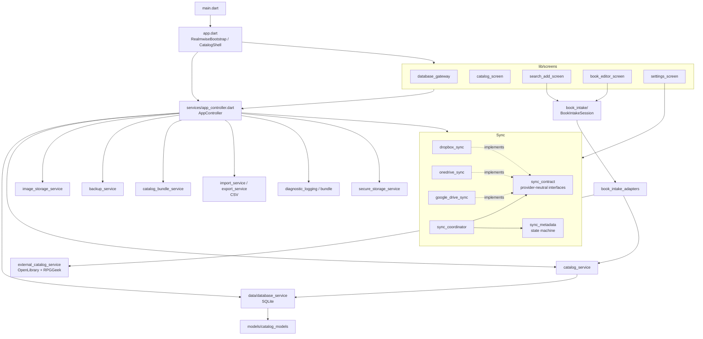

# Architecture map

Snapshot of `main` at `0141881` (2026-11-09). Realmwise is a single Flutter package (no internal packages) targeting Windows, Linux, and Android. Domain terms (**work**, **owned copy**, **work candidate**) are defined in [`CONTEXT.md`](../CONTEXT.md); decisions live in [`docs/adr/`](adr/).

## Layers

`AppController` is the composition root and the single `ChangeNotifier` the UI listens to. Screens call controller methods; only the settings screen and book intake reach past it into services directly.

## Modules

| Area | Files | Responsibility | Notes |
| --- | --- | --- | --- |
| Bootstrap | `main.dart`, `app.dart` | Loads Android OAuth config, builds the three sync providers, constructs `AppController`, optionally starts the debug harness, hosts `CatalogShell` navigation. | Debug harness is opt-in (`apiDebugHarnessEnabled()`). |
| Orchestration | `services/app_controller.dart` (~1450 lines) | Database open/create/close/restore, sync connect/disconnect/automatic sync and lease, bundle import/export, theme and hierarchy preferences, catalog icons, RPGGeek key, CSV import/export, "new this session" tracking. | Largest seam in the app. Most features change this file. |
| Domain model | `models/catalog_models.dart` | `BookWork`, `UserCopy`, `BookCondition`, `BookImage`, `CatalogRecord` (work + copies + images), `WorkCandidate`. | Immutable value types with `copyWith` / map serialization. |
| Persistence | `data/database_service.dart` | SQLite via `sqflite` (FFI on desktop). Tables `works`, `copies`, `images`, `settings`, `catalog_icons`. Schema version 5 with additive `onUpgrade` migrations. Owns catalog identity. | Schema changes need a version bump and an upgrade step. |
| Catalog use cases | `services/catalog_service.dart` | Save/delete records, suggestions, tags, image rehydration, backup listing. | Thin facade over `DatabaseService` plus images. |
| Book intake | `book_intake/book_intake_session.dart`, `book_intake_adapters.dart` | Visit-scoped lookup → candidate selection → duplicate check → editor handoff. Typed outcomes (`IntakeDuplicateRequest`, `IntakeEditorRequest`, `IntakeRefreshCandidate`, ...). Dependencies are interfaces (`BookIntakeLookup`, `BookIntakeCatalog`, `BookIntakePreferences`, `BookIntakeKeyProvider`). | Implements [ADR 0001](adr/0001-book-intake-session.md). The best-isolated, best-tested module; use it as the pattern for new seams. |
| External lookup | `services/external_catalog_service.dart` | OpenLibrary search by ISBN/title/author; optional RPGGeek XML enrichment (RPGGeek values win). | Network only on user action. |
| Images | `services/image_storage_service.dart` | Downloads covers with format sniffing, ISBN-based filenames, managed local folder. | Custom TLS/socket hooks exist for testability. |
| Backups | `services/backup_service.dart` | Crash-recovery snapshots every 10 min while open, trimming, legacy-token scrubbing. | |
| Bundles | `services/catalog_bundle_service.dart` | `.realmwise` zip: `manifest.json` + `catalog.db` (+ optional personal images), logical fingerprint, validation, extraction. | Used by manual export/restore and by every sync provider. |
| Sync contract | `services/sync_contract.dart` | Provider-neutral interfaces: `SyncProvider`, `SyncAuthenticator`, `SyncTransfer`, `SyncLeaseProvider`, revisions/preconditions, conflict and lease exceptions. | Change here ripples into all three providers. |
| Sync orchestration | `services/sync_coordinator.dart`, `sync_metadata.dart` | Connect, classify local vs remote, resolve conflicts, upload/download, automatic sync lease (single active device), rebind after restore. Metadata stored per catalog identity in shared preferences. | Model is one active device + controlled handoff, never a merge. |
| Sync providers | `google_drive_sync.dart`, `onedrive_sync.dart`, `dropbox_sync.dart` + `*_runtime.dart` | OAuth (PKCE, loopback on desktop, platform callbacks on Android), token stores, provider-specific HTTP. `*_runtime.dart` holds the platform glue and build-mode (DEV/PROD) client selection. | Each provider ~650–1130 lines with parallel structure. |
| Secrets | `services/secure_storage_service.dart` | `TokenStorage` over `flutter_secure_storage`. OAuth tokens and the RPGGeek key (keyed by catalog identity) live here. | Legacy plaintext key in the DB is migrated out on read. |
| Diagnostics | `diagnostic_logging.dart`, `diagnostic_bundle_*.dart`, `sync_debug.dart` | Sanitizing logger, opt-in debug logging, exportable diagnostic bundle. | See [`diagnostics-privacy.md`](diagnostics-privacy.md). |
| Debug harness | `debug/api_debug_harness.dart`, `docs/openapi.yaml` | Loopback-only HTTP API + Swagger for exercising lookups. | Opt-in; never ships enabled. |
| UI | `screens/*`, `widgets/*`, `theme/app_theme.dart` | Catalog hierarchy (system → setting → type → title), add/search with barcode scanning, editor, settings (database, sync, appearance, diagnostics). Themes and cover placeholders. | `settings_screen.dart` (~1730 lines) and `book_editor_screen.dart` / `catalog_screen.dart` (~1100 each) are the largest widgets. |

## Key flows

- **Startup:** `RealmwiseBootstrap` → `AppController.initialize()` → reopen last database (or show `DatabaseGateway`) → start backups → restore sync metadata for the catalog identity.
- **Add a book:** `SearchAddScreen` → `BookIntakeSession` lookup → user picks a candidate → ISBN-13 duplicate check → `BookEditorScreen` → `CatalogService.save` → controller notifies → automatic sync debounced (5 s).
- **Sync:** `SyncCoordinator.classify` compares local fingerprint/metadata with remote revision → upload, download, or `SyncDecisionRequired` for the user → bundle swap quiesces the database, replaces it, and rebinds metadata.

## Tests

`test/` has one file per module (about 27 files). Sync providers are tested against fake HTTP clients; intake is tested through its interfaces per ADR 0001; widget tests cover drawer, navigation, editor, search, and settings. CI (`.github/workflows/ci.yml`) runs `dart format --set-exit-if-changed`, `flutter analyze`, `flutter test`, SBOM checks, and smoke builds for all three platforms.

## Known hotspots and drift

Observations for planning, not yet tracked as issues:

- `AppController` mixes database lifecycle, sync, bundles, preferences, and icons. The [architecture review](architecture-review-20260923-235117.html) proposes concentrating local catalog recovery; that has not landed.
- `disconnectOneDrive()` delegates to `disconnectGoogleDrive()`, which actually disconnects whichever provider is active. The name hides that.
- `CatalogBundleService.appVersion` is hard-coded to `1.0.0+1` while `pubspec.yaml` is `1.3.0+6`.
- README says the RPGGeek key is stored in the local database. It now lives in secure storage. The README's project map also undersells `test/`.
- A stray empty file named `$null` is tracked at the repo root (from a PowerShell redirect).
- Backlog items live in [`todo.md`](../todo.md) (duplicate detection beyond ISBN-13; consistent ISBN-13 checksum on typed input).
